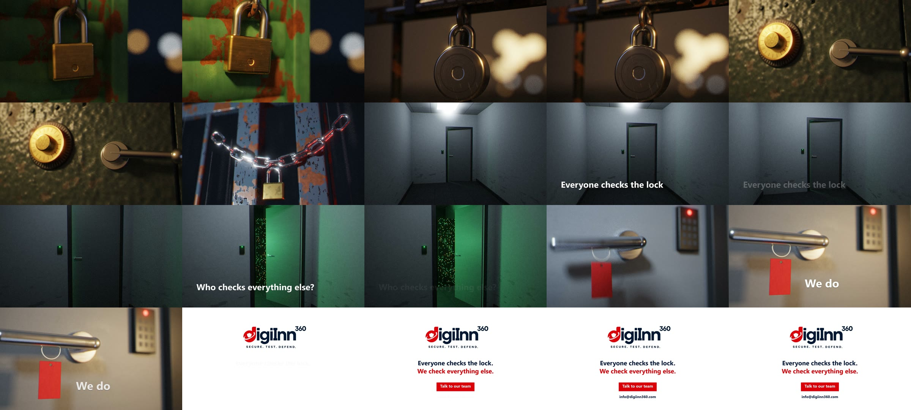
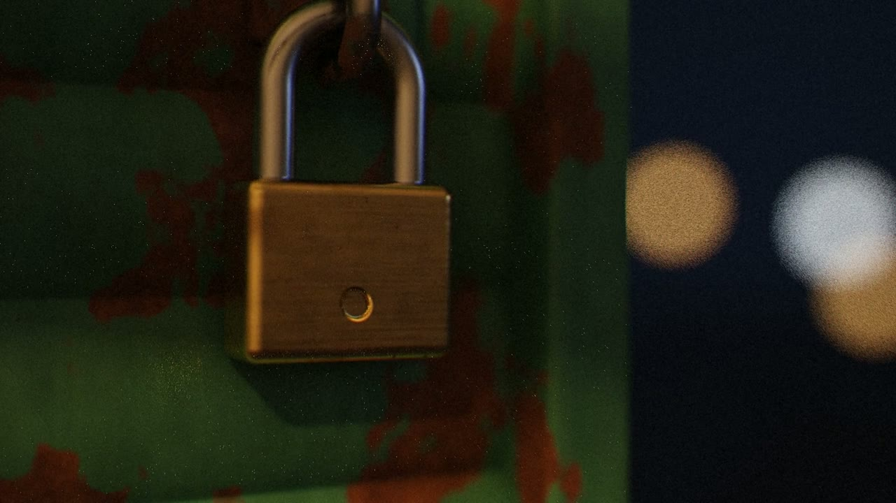
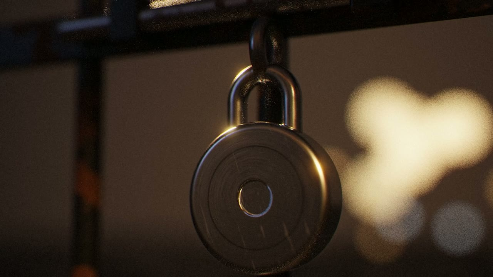
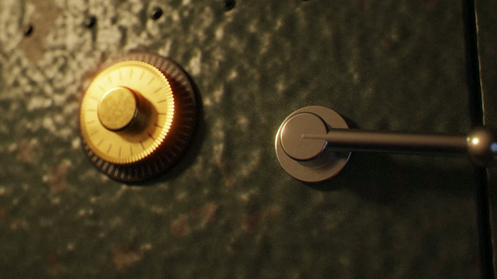
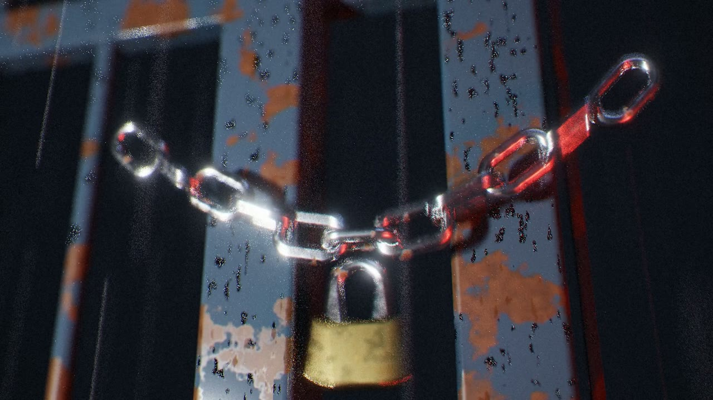
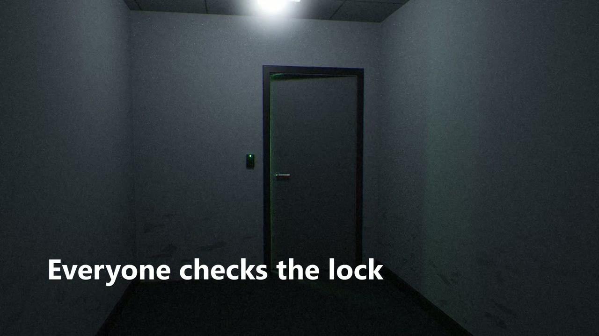
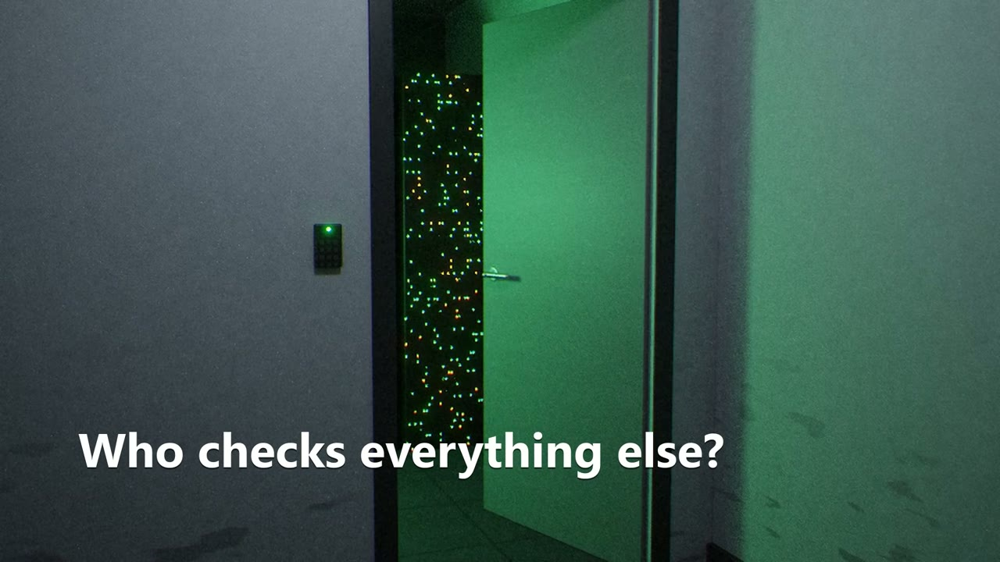
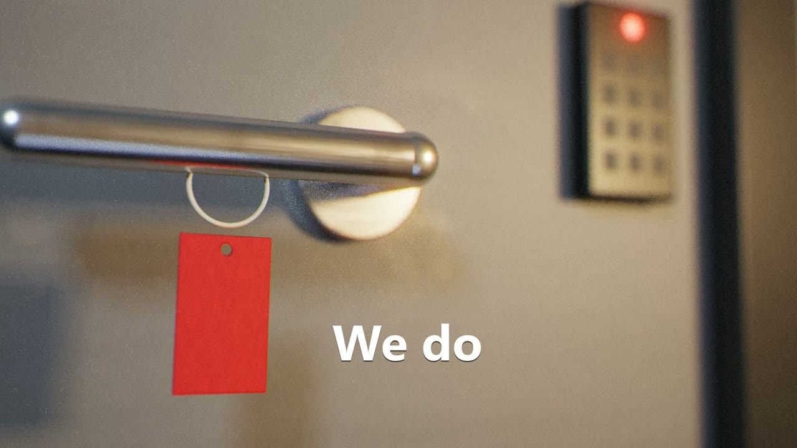

# The Tug

A 24-second cybersecurity ad for [Digiinn360](https://digiinn360.com) in which every pixel and every sound is computed by about 1,150 lines of code. There is no camera, no stock footage, no 3D software, no texture or model files, no sound library, and no AI video, image or audio generator.

[](media/the-tug.mp4)

**Watch:** [media/the-tug.mp4](media/the-tug.mp4) (1920x1080, 24 fps, 24.4 s, stereo)

## The idea

Everyone tugs a padlock after locking it. Nobody tugs their network.

| Time | Shot | What happens |
| --- | --- | --- |
| 0.0 s | Bazaar shutter | A brass padlock is tugged twice and left swinging |
| 2.6 s | House gate | A steel disc lock on wrought iron, tugged twice |
| 4.9 s | Safe | The dial spins shut, the lever is pulled twice |
| 6.9 s | Factory gate | A chain and padlock rattled in the rain |
| 8.7 s | Office corridor | Silence. A server-room door stands slightly open. *Everyone checks the lock* |
| 12.2 s | Same corridor | The door swings open by itself. *Who checks everything else?* |
| 15.8 s | Door handle | The keypad turns red, the lever is tugged and holds. *We do* |
| 19.8 s | End card | Logo and the line: *Everyone checks the lock. We check everything else.* |

No person appears on screen. The tugging hand is implied by the motion of each lock and by the shadow of an arm that sits just outside the frame.

| | | | |
| --- | --- | --- | --- |
|  |  |  |  |
|  |  |  |  |

## What "not AI generated" means here

No frame came out of a diffusion or video model. Each frame is the result of simulating light: rays leave a virtual lens, bounce off surfaces described by mathematical functions, and are averaged until the noise settles. The result is deterministic. The same command renders the same frame again.

The code itself was written by Claude (Anthropic's model, in Claude Code) under human direction, with a person approving the concept and reviewing the frames. So an AI wrote the renderer, and the renderer made the film.

## How it works

```
shotN.glsl ──┐
common.glsl ─┼─► pt.py ──► out/shotN.mp4 ──┐
             │   (GPU path tracing,        ├─► assemble.py ──► the-tug.mp4
             │    CPU lens and film)       │   (cut, titles, end card, mux)
audio.py ────┴──────────► out/film.wav ────┘
```

| File | Lines | Job |
| --- | --- | --- |
| [tracer/common.glsl](tracer/common.glsl) | 177 | The path tracer: ray marching, materials, light sampling, lens |
| [tracer/shot1.glsl](tracer/shot1.glsl) to [shot7.glsl](tracer/shot7.glsl), [office.glsl](tracer/office.glsl) | 654 | One scene each: geometry, materials, lights, motion, camera |
| [tracer/pt.py](tracer/pt.py) | 123 | Runs the shader, accumulates samples, grades, pipes frames to ffmpeg |
| [tracer/audio.py](tracer/audio.py) | 113 | Synthesises the whole soundtrack |
| [tracer/assemble.py](tracer/assemble.py) | 53 | Cuts the shots, adds titles and the end card, muxes sound |
| [tracer/render_all.py](tracer/render_all.py) | 28 | Runs everything with the released settings |

### 1. Geometry is a function, not a mesh

Every scene is a signed distance function: `map(p)` returns how far point `p` is from the nearest surface and which material that surface is. A padlock is a rounded box, a torus section for the shackle and a cylinder for the keyhole, combined with `min`. The roller shutter's slats are one line:

```glsl
float slat(float y) { float s = abs(sin(PI * y / 0.046)); return 0.0085 * pow(s * s + 0.004, 0.32); }
```

Rays find surfaces by sphere tracing: step forward by the distance `map` returns, up to 110 steps, until the distance falls under a threshold that grows with distance from the camera. Normals come from four extra `map` samples in a tetrahedron pattern. Scenes are modelled in metres at real size, so a padlock body is about 4 cm wide.

### 2. Materials are noise

There are no image textures. Rust, chipped paint, brushed brass, hammered safe enamel, carpet tiles, fingerprints near a door handle and paper fibre are all built from one five-octave value-noise function (`fbm`) evaluated at the hit point. Each material sets a base colour, metalness, roughness, emission and a small normal perturbation. Brushed metal, for example, stretches the noise along one axis:

```glsl
float br = fbm(vec3(q.x * 60.0, q.y * 1400.0, q.z * 1400.0));
m.rough = clamp(0.20 + 0.14 * br - 0.08 * wear, 0.13, 0.6);
```

### 3. Light transport

[common.glsl](tracer/common.glsl) is a unidirectional path tracer with up to four bounces per path.

- **Surface model:** GGX microfacet specular with Smith geometry and Schlick Fresnel, plus Lambert diffuse, in the metal/roughness convention.
- **Direct light:** at every non-mirror hit, each sphere light is sampled once with a shadow ray (next-event estimation). The light is treated as a disc of area πr² facing the surface.
- **Indirect light:** the next direction is chosen either from the GGX lobe or cosine-weighted over the hemisphere, with a probability driven by Fresnel and metalness, and the path weight is divided by that probability.
- **No double counting:** a path only picks up a light source it runs into if the previous bounce was the camera or a mirror (roughness under 0.12), because rougher surfaces have already sampled the lights directly.
- **Bokeh emitters:** distant street and window lights are emissive spheres that are visible to the camera and to reflections but are not sampled as lights. Out of focus, they become the soft discs behind the locks.
- **Environment:** each shot defines a small procedural `sky(rd)` so metal has something to reflect.

### 4. Camera, depth of field and motion blur

The camera is a thin lens. Each sample picks a random point on the aperture disc and aims at the focal plane, so anything off that plane blurs by the right amount for its distance. The macro shots use an aperture radius of 8 to 12 mm with fields of view of 22 to 31 degrees, which is what gives them the shallow focus.

Motion blur is done the same way a film camera does it. Every sample gets its own time inside a 180-degree shutter (1/48 s at 24 fps):

```glsl
gT = uTime + (rnd() - 0.5) * uShutter;
```

Because all motion is a function of `gT`, a lock that is mid-jerk is smeared across the frame with no extra code.

### 5. Motion is written as physics-shaped functions

Nothing is keyframed. A tug is a Gaussian pulse of displacement. The shiver after it is a decaying sine. A released padlock is a damped pendulum:

```glsl
float jerk(float t)  { float a = (t - 0.22) / 0.04, b = (t - 0.58) / 0.04; return 0.0055 * exp(-a * a) + 0.0065 * exp(-b * b); }
float swing(float t) { float u = t - 0.86; return ... 0.20 * exp(-1.25 * u) * sin(u * 14.0); }
```

The server-room door opens on a smoothstep over 2.3 seconds. The corridor's fluorescent tube flickers from a hash of the time in 1/17 s steps. The rain in shot 4 is a repeating grid of cells, each holding one vertically stretched drop that falls at its own hashed speed. The chain is eleven links whose positions follow a sagging curve that is shaken by the same pulse functions.

### 6. Accumulating samples on a laptop GPU

[pt.py](tracer/pt.py) opens an OpenGL 3.3 context with `moderngl` and draws one full-screen triangle per sample. Each draw is one path per pixel, added into a 32-bit float framebuffer with additive blending. The alpha channel counts samples, and the host refuses a frame in which any pixel is short of the requested count.

The machine this was made on has Intel UHD integrated graphics, which resets the driver if a single draw call runs too long. Each sample is therefore split into four horizontal strips with a scissor rectangle, and the context is flushed after every strip.

Random numbers come from a PCG hash seeded from the pixel coordinates and the sample index.

### 7. Lens and film, on the CPU

After accumulation the linear HDR frame is graded in numpy and scipy:

1. Exposure.
2. Despeckle: a pixel may not be much brighter than its blurred neighbourhood, which removes fireflies.
3. Bloom from everything above 1.0, at three blur radii.
4. Chromatic aberration: the red channel is scaled up by 0.15% and blue down by 0.15% about the centre.
5. Vignette.
6. ACES filmic tone curve, then gamma 2.2.
7. Film grain, seeded per frame, weaker in the highlights.

Frames go straight into ffmpeg's stdin as raw RGB and are encoded with libx264 at CRF 14.

### 8. Sound is synthesised from the same numbers

[audio.py](tracer/audio.py) builds a 48 kHz stereo track in numpy with no recordings. Each sound is placed at *shot start on the edit timeline + event time inside the shot*, using the same constants the shaders use, so picture and sound cannot drift.

- **Metal clacks:** a 1 ms noise click, plus a sum of inharmonic decaying sine partials, plus a low body thump. Brass, steel, wrought iron and the door handle each have their own partial table.
- **Rattles:** low-passed noise, amplitude-modulated at 14 to 22 Hz.
- **Rain:** white noise minus its own low-passed copy, cut off hard into silence at the corridor.
- **Office:** 50 Hz mains hum with two harmonics and filtered air noise. The tube buzzes on the same hash that makes it flicker on screen.
- **Door:** a slow noise swell for the hinge, then server fans rising as it opens.
- **End card:** a five-partial low pad built on a fifth and an octave.

### 9. The edit

[assemble.py](tracer/assemble.py) is one ffmpeg filter graph: trim each shot, scale to 1920x1080 with Lanczos and a light unsharp mask, concatenate, draw the three title lines with alpha fades, fade to white, and append the end card (logo, two lines of copy, a button, an address). The soundtrack is raised 5.5 dB through a limiter and muxed as AAC. The finished file measures -18.6 LUFS integrated with a true peak of -1.0 dBFS.

## Render settings and times

Rendered on a 13th-gen Intel Core i5-1334U laptop with Intel UHD integrated graphics (OpenGL 3.3).

| Shot | Resolution | Samples per pixel | Frames | Time |
| --- | --- | --- | --- | --- |
| 1. Bazaar shutter | 1280x720 | 160 | 67 | 22.4 min |
| 2. House gate | 1280x720 | 160 | 58 | 15.0 min |
| 3. Safe | 1280x720 | 144 | 52 | 13.7 min |
| 4. Chain in rain | 1280x720 | 80 | 48 | 50.4 min |
| 5. Corridor | 960x540 | 80 | 84 | 54.2 min |
| 6. Door opens | 960x540 | 80 | 86 | about 50 min |
| 7. Lever and tag | 1280x720 | 96 | 96 | 15.4 min |

Shots 5 to 7 shared the GPU with other renders, so their times are longer than they would be alone. Shot 6's logged time includes hours the laptop spent asleep; the figure above is frames times the measured rate of about 36 s per frame. All shots are upscaled to 1080p in the edit.

## Run it

Requirements: Python 3.10 or newer, a GPU with OpenGL 3.3, and `ffmpeg` on the PATH.

```
pip install -r requirements.txt
cd tracer
```

One still:

```
python pt.py shot1 --t 0.58 --w 640 --h 360 --spp 64 --exposure 1.3 --png padlock.png
```

The corridor (shot files are joined with `+`):

```
python pt.py shot6+office --t 3.0 --w 640 --h 360 --spp 64 --exposure 1.6 --png door.png
```

A fast, noisy preview of the whole film:

```
python render_all.py --preview
```

The full film, about 3.5 hours on the laptop above:

```
python render_all.py
```

`assemble.py` uses Segoe UI Bold from the Windows fonts folder. On other systems, set the `FONT` environment variable to any bold `.ttf` file.

## Limits

- It reads as high-end 3D, not as camera footage. The macro shots hold up best; the corridor is the plainest.
- The tracer is biased: path weights are clamped, radiance is clamped at 60, and the despeckle pass removes energy.
- Emissive surfaces are seen by the camera and in mirrors but do not light the scene. Anything that needs to cast light has a matching sphere light.
- There is no refraction, no subsurface scattering, no volumetrics and no denoiser. Noise is handled with sample count and film grain.
- Light sampling uses one sample per light without multiple importance sampling, so small bright lights reflected in rough metal converge slowly.
- The two corridor shots were rendered at 960x540 and are softer than the rest.

## Credits

- Concept, direction and review: Digiinn360.
- Code: written with Claude (Claude Code).
- Method: inspired by [Cat Garden](https://github.com/BubbleBrainBB/awesome-fable-5.2/tree/main/cat-garden), which showed that a hand-written path tracer plus synthesised audio can carry a whole film. No code from it is used here.
- Concept development used the [creative-director](https://github.com/smixs/creative-director-skill) and [visual-skills](https://github.com/smixs/visual-skills) skills by Serge Shima (CC BY 4.0).
- Encoding: [FFmpeg](https://ffmpeg.org). GPU access: [moderngl](https://github.com/moderngl/moderngl).

The Digiinn360 name and logo in `assets/` are trademarks of Digiinn360 and are not covered by any licence on the code.
